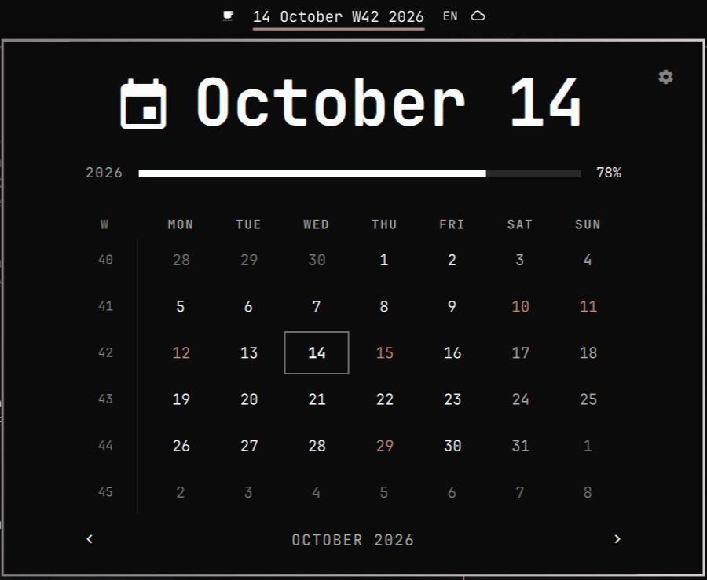
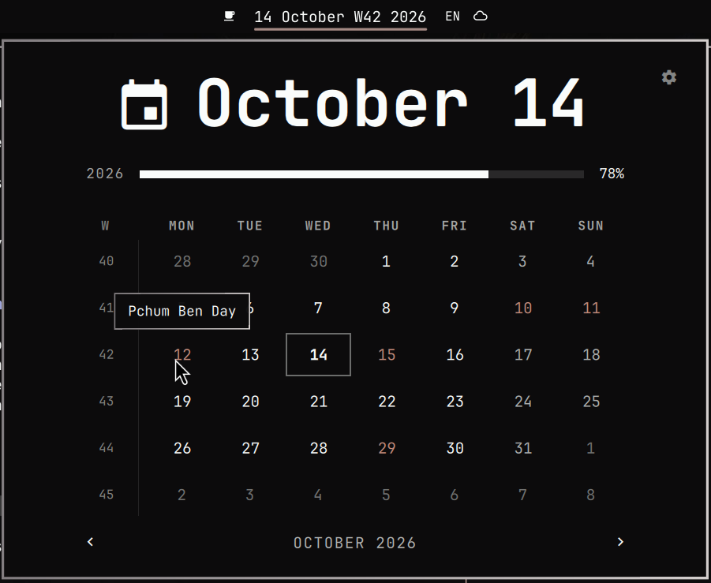
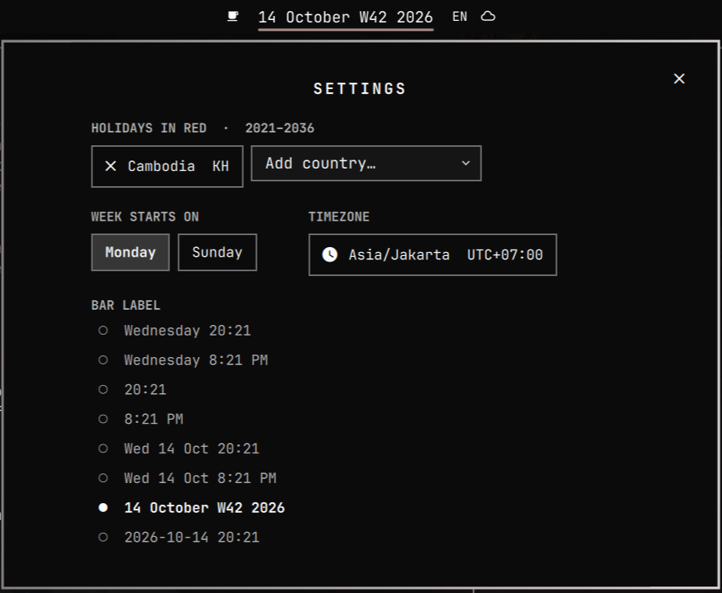
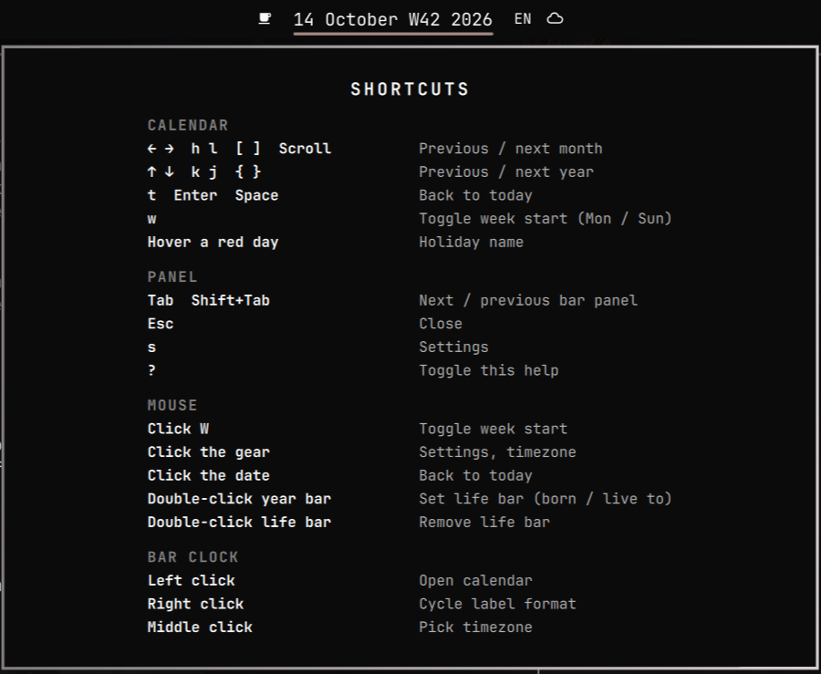

# clock-byxax

**Omarchy's calendar, now with public holidays — for your country, in red.**



- 🔴 **Holidays in red** — ~250 countries, lunar ones too (Khmer New Year, Pchum Ben, Lunar New Year…)
- ⚙️ **Settings in the popup** — countries, week start, bar format, timezone
- ⌨️ **Press `?`** — every shortcut at a glance
- 🔄 **Always current** — tracks every Omarchy release automatically
- 📴 **Offline** — nothing is fetched, ever

## Install

```sh
omarchy plugin add https://github.com/houtvongsak/clock-byxax.git --enable --yes
```

It takes the built-in clock's place and keeps your clock settings. Then
click the ⚙️ in the calendar and pick your countries.

## Screenshots

| Hover a red day | Settings (⚙️ or `s`) | Shortcuts (`?`) |
|---|---|---|
|  |  |  |

## Update / remove

```sh
omarchy plugin update io.github.houtvongsak.clock-byxax
omarchy plugin remove io.github.houtvongsak.clock-byxax   # stock clock comes back
```

---

Built on Omarchy's own [`omarchy.clock`](https://github.com/basecamp/omarchy).
Holiday data from [python-holidays](https://github.com/vacanza/holidays).
